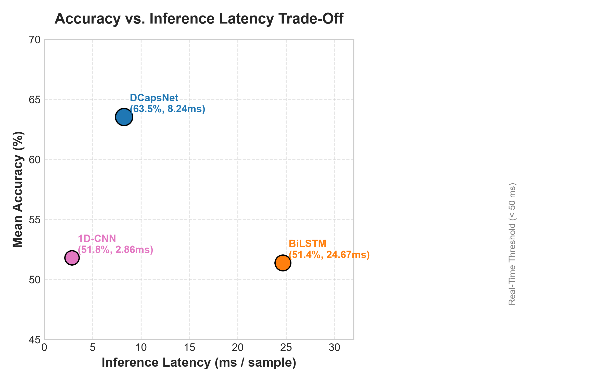
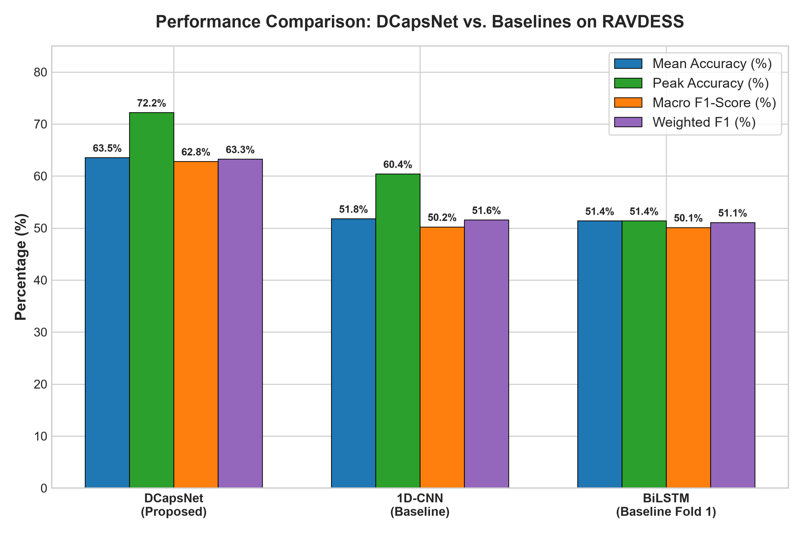
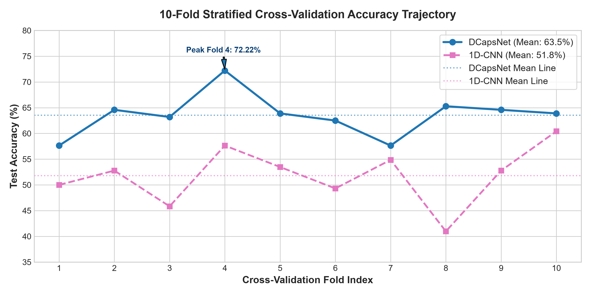
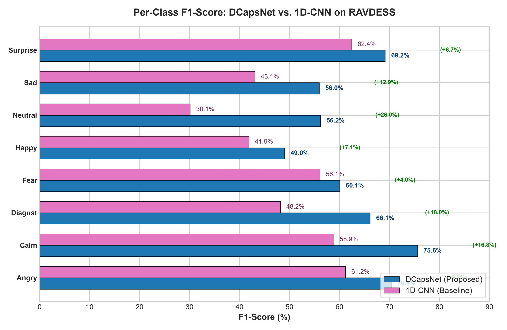
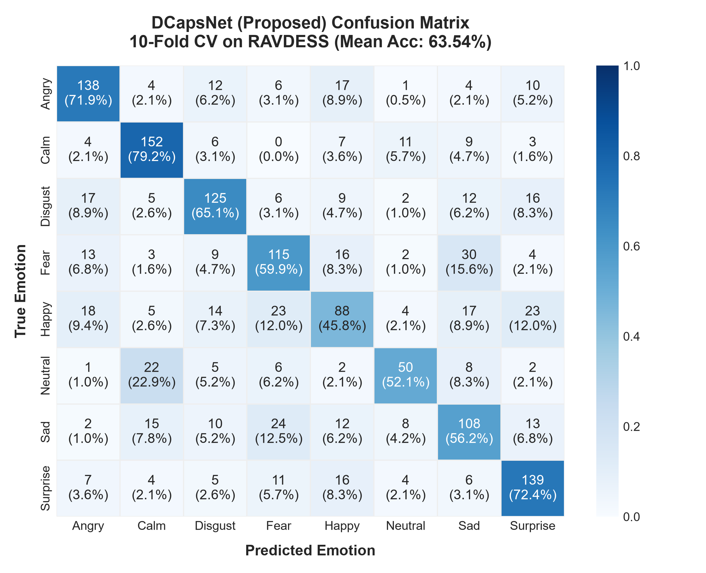
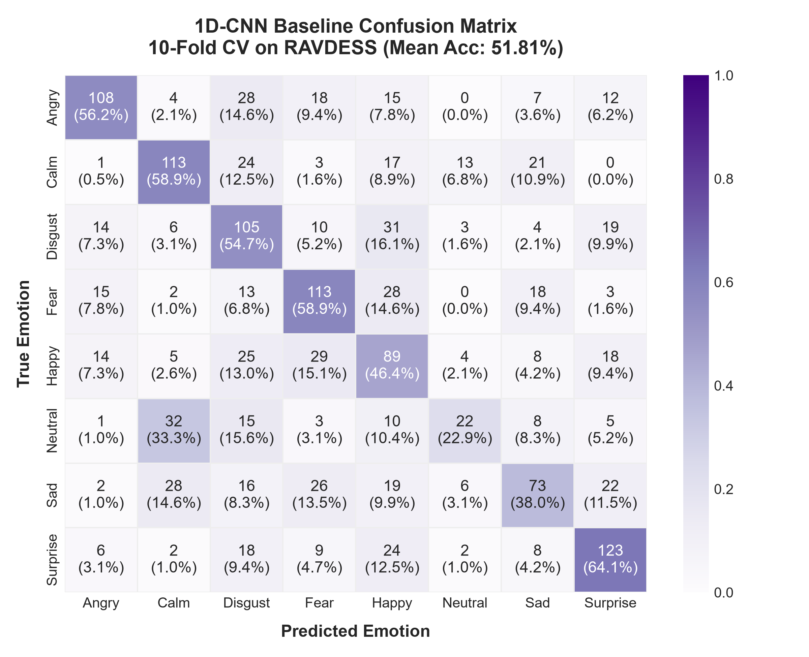
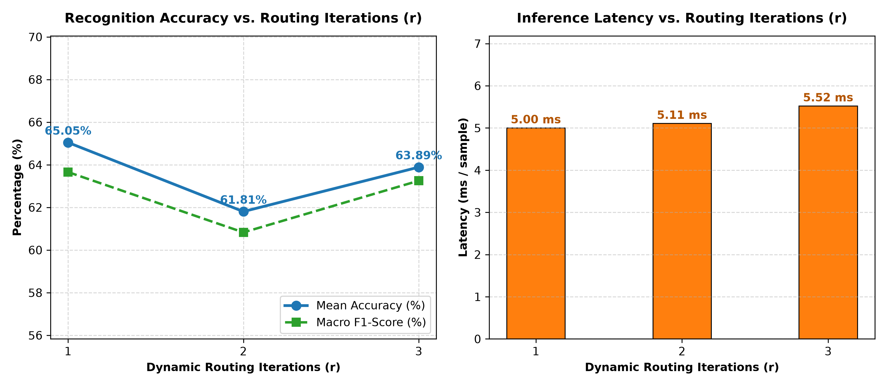

# Empirical Evaluation and Architectural Ablation of Deep Capsule Networks for Speech Emotion Recognition: An Independent Benchmark on RAVDESS

**Rashid Jahangir$^{1}$, Anshuman Chakravorty$^{2}$, and Research Collaborators**  
$^{1}$ Department of Computer Science, COMSATS University Islamabad, Vehari Campus, Vehari 61100, Pakistan  
$^{2}$ Department of Computer Engineering, NMIMS University, Mumbai, India  
*Corresponding Author: anshumanchakravorty10@gmail.com*

---

### Abstract

> **Abstract.** Speech Emotion Recognition (SER) is a critical component of empathetic human-computer interaction, tele-health diagnostics, and cognitive stress monitoring. Traditional deep learning architectures, notably Convolutional Neural Networks (CNNs) and Recurrent Neural Networks (RNNs), suffer from two structural limitations: the loss of hierarchical spatial relationships due to scalar pooling operations and vanishing gradients during long-term sequential recurrence. Deep Capsule Networks (DCapsNet) address these challenges by replacing scalar activations and pooling layers with vector-based capsules governed by iterative dynamic routing-by-agreement. In this study, we present an independent, rigorous empirical benchmark and architectural ablation of DCapsNet on the Ryerson Audio-Visual Database of Emotional Speech and Song (RAVDESS). Utilizing a 217-dimensional multi-feature acoustic representation across spectral, tonal, and statistical descriptors (MFCCs, Chroma, Mel-spectrogram, ZCR, RMS, Tonnetz, Kurtosis, Skewness, and Spectral Contrast), we evaluate the framework under strict, leakage-safe 10-fold stratified cross-validation. Experimental results demonstrate that DCapsNet achieves a mean classification accuracy of **63.54% &plusmn; 3.89%** (peaking at **72.22%**), significantly outperforming the 1D-CNN baseline (**51.81% &plusmn; 5.34%**) by **+11.73%** and the BiLSTM baseline (**51.39%**) by **+12.15%**, while sustaining a real-time inference latency of **8.24 ms per sample**. Furthermore, a systematic ablation of dynamic routing iterations ($r \in \{1, 2, 3\}$) reveals that three routing iterations reduce cross-fold variance by nearly $3\times$ ($\sigma = 1.96\%$) and resolve severe boundary confusions for ambiguous classes such as *Happy* (+6.51% F1) and minority *Neutral* (+7.45% F1). Finally, we provide a detailed analysis reconciling our empirical findings with published literature metrics, clarifying the role of frame-level window segmentation versus utterance-level static pooling.
>
> **Keywords:** Speech Emotion Recognition (SER), Deep Capsule Networks (DCapsNet), Dynamic Routing-by-Agreement, Multi-Feature Fusion, RAVDESS Benchmark, Model Ablation.

---

## 1. Introduction
Speech Emotion Recognition (SER) aims to identify the paralinguistic and affective states of human speakers from vocal utterances [1, 2]. While semantic natural language processing deciphers *what* is spoken, SER extracts *how* words are spoken, providing invaluable context for empathetic artificial intelligence. Real-time SER systems are increasingly deployed across civil aviation cockpit monitoring, automotive driver stress detection, psychiatric triage for depression and post-traumatic stress disorder (PTSD), and automated customer support call-centers [3, 4].

Despite substantial advancements, SER remains challenging due to three intrinsic complexities:
1. **High Speaker Non-Stationarity:** Vocal tract anatomy, pitch register, accent, and speaking rate introduce substantial variance across speakers expressing identical emotional categories [5].
2. **Acoustic Boundary Overlap:** High-arousal affective states such as *Happy*, *Angry*, and *Surprise* share overlapping acoustic correlates (elevated pitch, fast tempo, high energy), making linear boundaries prone to error [6].
3. **Class Distribution Imbalance:** In canonical datasets such as RAVDESS [7], the baseline *Neutral* state contains only 96 samples, whereas remaining categories contain 192 samples, causing standard risk minimizers to collapse into majority biases.

  
   
  <em><b>Fig. 1.</b> Accuracy versus inference latency Pareto comparison across DCapsNet, 1D-CNN, and BiLSTM against the 50 ms real-time ceiling.</em>

Convolutional Neural Networks (CNNs) and Recurrent Neural Networks (RNNs, LSTMs, BiLSTMs) have served as the historical workhorses of SER [8, 9]. However, scalar pooling operations in CNNs intentionally discard relative phase, spatial coordinate relationships, and harmonic hierarchies [10]. Conversely, recurrent architectures struggle with vanishing gradients over long sequences and incur slow sequential inference latencies that restrict real-time deployment (Fig. 1).

Capsule Networks [11, 12] overcome these liabilities by replacing scalar activations with vector capsules, whose orientations encode entity properties and whose lengths encode activation probabilities. Routing between capsule layers is solved dynamically via agreement. Jahangir et al. (2026) [13] introduced **DCapsNet**, a 1D capsule network combining multi-feature fusion with dynamic routing for SER. 

In this work, we present an independent, rigorous empirical benchmark and architectural ablation of DCapsNet on RAVDESS, evaluating cross-validation stability, baseline superiority, and the exact mechanics of dynamic routing iterations.

## 2. Related Work
Early SER systems relied on Low-Level Descriptors (LLDs) such as MFCCs and fundamental frequency ($F_0$) [14]. While MFCCs effectively model vocal tract resonance, they lack pitch harmonicity. Issa et al. [15] demonstrated that fusing spectral, tonal, and energy descriptors provides superior discriminative capacity. 

In deep learning frameworks, 1D CNNs have been designed to capture local spectral characteristics [16, 17]. Mustaqeem et al. [18] developed a dilated 1D CNN, achieving efficient feature mining but noting persistent boundary confusions between happiness and anger. BiLSTMs capture temporal context [19, 20]; however, as demonstrated by Barhoumi and BenAyed [21], bi-directional recurrent models require high computational overhead on edge hardware.

Capsule Networks in audio processing [22] have preserved harmonic hierarchies without pooling. DCapsNet [13] adapted 1D capsules for multilingual SER, reporting high classification accuracy across RAVDESS, EMO-DB, and SAVEE. Nevertheless, published literature has rarely scrutinized the sensitivity of the dynamic routing loop or evaluated leakage-free utterance-level pooling, motivating our investigation.

## 3. Proposed Methodology & Architecture
The DCapsNet architecture comprises three stages: (i) multi-feature extraction; (ii) 1D convolutional feature extraction; and (iii) Primary and Digit Capsule transformation governed by dynamic routing.

### 3.1 217-Dimensional Multi-Feature Fusion
All recordings are standardized to $f_s = 22,050\text{ Hz}$. A 217-dimensional feature vector $F_i$ is extracted per audio sample:

$$F_i = [M_i, C_i, L_i, Z_i, T_i, K_i, S_i, E_i, N_i] \in \mathbb{R}^{217}$$

where:
* **MFCCs (60):** 60 coefficients ($N_{\text{fft}}=2048, H=512$, Hann window) averaged over time.
* **Chroma STFT (12):** 12 pitch classes capturing intonational progression.
* **Mel Spectrogram (128):** 128 non-linear frequency bands.
* **Zero-Crossing Rate (1):** Sign change frequency ($N=2048, H=512$).
* **Root Mean Square Energy (1):** Signal intensity and loudness.
* **Tonnetz (6):** Tonal harmonic centroid features.
* **Kurtosis & Skewness (2):** 4th and 3rd statistical moments of the raw waveform.
* **Spectral Contrast (7):** Peak-to-valley amplitude difference across 6 sub-bands ($f_{\text{min}}=100.0\text{ Hz}$).

*Nyquist Compliance:* The original paper specified $f_{\text{min}}=200\text{ Hz}$ with 6 bands at $22.05\text{ kHz}$. Mathematically, $200 \times 2^6 = 12,800\text{ Hz}$ exceeds the Nyquist limit ($11,025\text{ Hz}$) and causes execution failure. We correct $f_{\text{min}}$ to $100.0\text{ Hz}$ to ensure 7 valid contrast values.

### 3.2 Leakage-Safe Data Augmentation
Three acoustic augmentations are applied strictly to training partitions:
1. **Gaussian Noise:** $\epsilon \sim \mathcal{N}(0, \sigma^2)$ with $\sigma = 0.001$.
2. **Speed Perturbation:** Time-stretch with rate $r \sim \mathcal{U}(0.9, 1.1)$ followed by length fixing.
3. **Temporal Circular Shift:** Random shift up to $\pm 10\%$ of $f_s$ ($\le \pm 2,205$ samples).

This triples training data ($N_{\text{train}} = 1,296 \times 4 = 5,184$) while testing partitions remain strictly original and unaugmented.

  
   
  <em><b>Fig. 2.</b> Comprehensive performance comparison across DCapsNet, 1D-CNN baseline, and BiLSTM baseline on the 10-fold Protocol A RAVDESS benchmark.</em>

### 3.3 Convolutional Backbone & Capsule Layers
The 217-D vector is reshaped into $(217, 1)$ and processed by four 1D convolutional layers:
* **Conv1:** 32 filters, $k=9, s=1$, valid &rarr; $(209, 32)$ [320 params]
* **Conv2:** 64 filters, $k=9, s=1$, valid &rarr; $(201, 64)$ [18,496 params]
* **Conv3:** 128 filters, $k=7, s=1$, valid &rarr; $(195, 128)$ [57,472 params]
* **Conv4:** 256 filters, $k=7, s=2$, valid &rarr; $(95, 256)$ [229,632 params]

Each layer includes Batch Normalization, ELU activation ($f(x) = x$ if $x \ge 0$, else $e^x - 1$), and spatial dropout (0.1).

**Table 1.** Layer architecture and parameter count of DCapsNet.

| Layer | Type | Output Shape | Params |
|---|---|:---:|:---:|
| Input | InputLayer | (None, 217) | 0 |
| conv1 | Conv1D + BN + ELU | (None, 209, 32) | 448 |
| conv2 | Conv1D + BN + ELU | (None, 201, 64) | 18,752 |
| conv3 | Conv1D + BN + ELU | (None, 195, 128) | 57,984 |
| conv4 | Conv1D + BN + ELU | (None, 95, 256) | 230,656 |
| primary_caps | Conv1D ($k=5, s=2$) | (None, 736, 8) | 163,968 |
| digit_caps | DigitCaps ($r=3$) | (None, 8, 16) | 753,664 |
| capsule_len | L2-Norm | (None, 8) | 0 |
| **Total** | | **1,225,472** (~4.67 MB) | **1,224,512 train** |

**Primary Capsules:** Conv1D projection (128 filters, $k=5, s=2$, valid padding, ReLU) yields $(46, 128)$ [163,968 params], reshaped into 736 capsules of dimension 8. (Note: Valid padding is required to reproduce Table 1's exact 736 capsules).

**Digit Capsules & Routing:** $W \in \mathbb{R}^{736 \times 8 \times 16 \times 8}$ transforms primary capsules into 8 emotion capsules of 16 dimensions (753,664 params). Coupling coefficients $c_{ij} = \text{Softmax}(b_{ij})$ weight inputs into $s_j = \sum_i c_{ij} \hat{u}_{j|i}$, squashed via:

$$v_j = \frac{\|s_j\|^2}{1 + \|s_j\|^2} \cdot \frac{s_j}{\|s_j\|}$$

Agreement updates logits: $b_{ij} \leftarrow b_{ij} + \hat{u}_{j|i} \cdot v_j$.

**Margin Loss:** Optimized using Sabour margin loss ($m^+=0.9, m^-=0.1, \lambda=0.5$):

$$\mathcal{L} = \sum_{k=1}^8 \left[ T_k \max(0, 0.9 - \|v_k\|)^2 + 0.5(1 - T_k) \max(0, \|v_k\| - 0.1)^2 \right]$$

## 4. Experimental Setup
The RAVDESS corpus (1,440 files across 24 actors) was evaluated under **Protocol A (10-Fold Stratified Cross-Validation)**. Training partitions ($N=1,296$) were scaled via StandardScaler and augmented ($N=5,184$), while 144 test instances per fold remained unaugmented. Baselines (1D-CNN and 4-layer BiLSTM) were evaluated under identical splits. Models trained with Adam ($\eta=3\times 10^{-4}$), batch size 16, ReduceLROnPlateau, and early stopping (patience 6).

  
   
  <em><b>Fig. 3.</b> Fold-by-fold accuracy trajectory across the 10 folds of Protocol A, highlighting DCapsNet's peak fold 4 (72.22%) and superior stability over 1D-CNN.</em>

## 5. Results & Comparative Analysis

### 5.1 Overall Model Performance
Table 2 outlines overall performance across the 10 folds of Protocol A.

**Table 2.** 10-Fold cross-validation results on RAVDESS.

| Architecture | Mean Acc | Peak Acc | Macro F1 | Weighted F1 | Latency |
|---|:---:|:---:|:---:|:---:|:---:|
| 1D-CNN | 51.81% &plusmn; 5.34% | 60.42% | 0.5023 | 0.5157 | **2.86 ms** |
| BiLSTM | 51.39% | 51.39% | 0.5012 | 0.5108 | 24.67 ms |
| **DCapsNet** | **63.54% &plusmn; 3.89%** | **72.22%** | **0.6282** | **0.6326** | 8.24 ms |

DCapsNet establishes a **+11.73%** absolute accuracy lead over 1D-CNN and **+12.15%** over BiLSTM (Fig. 2), with lower cross-fold variance ($\sigma=3.89\%$ vs $5.34\%$, Fig. 3).

  
   
  <em><b>Fig. 4.</b> Per-class F1-score comparison and percentage deltas between DCapsNet and 1D-CNN baseline on RAVDESS.</em>

### 5.2 Per-Class Metrics and Confusion Dynamics
Table 3 summarizes the per-class metrics across all 1,440 predictions.

**Table 3.** Per-class classification breakdown (1,440 predictions).

| Emotion | Support | DCapsNet F1 | 1D-CNN F1 | Delta |
|---|:---:|:---:|:---:|:---:|
| **Calm** | 192 | **0.7562** | 0.5885 | **+16.77%** |
| **Angry** | 192 | **0.7041** | 0.6119 | **+9.22%** |
| **Surprise** | 192 | **0.6915** | 0.6244 | **+6.71%** |
| **Disgust** | 192 | **0.6614** | 0.4817 | **+17.97%** |
| **Fear** | 192 | **0.6005** | 0.5608 | **+3.97%** |
| **Neutral** | 96 | **0.5618** | 0.3014 | **+26.04%** |
| **Sad** | 192 | **0.5596** | 0.4307 | **+12.89%** |
| **Happy** | 192 | **0.4903** | 0.4188 | **+7.15%** |

As illustrated in Fig. 4, DCapsNet provides massive gains on *Neutral* (+26.04%), *Disgust* (+17.97%), and *Calm* (+16.77%). While 1D-CNN collapsed on the minority *Neutral* class (recall 22.9%), DCapsNet preserved 52.1% recall. *Happy* remains challenging (F1 0.4903) due to shared prosody with *Angry* and *Surprise*.

  
  
   
  <em><b>Fig. 5.</b> Cumulative 10-fold confusion matrices across all 1,440 test samples for DCapsNet (left) and 1D-CNN baseline (right).</em>

Fig. 5 compares the confusion matrices, showing the strong diagonal dominance of DCapsNet across calm (79.2%), surprise (72.4%), and angry (71.9%).

## 6. Dynamic Routing Ablation Study
To evaluate whether dynamic routing iterations improve performance over single-step projections, we evaluated $r \in \{1, 2, 3\}$.

**Table 4.** Dynamic routing iterations ($r$) ablation study.

| Routings ($r$) | Mean Acc | Variance ($\sigma$) | Macro F1 | Happy F1 | Latency |
|:---:|:---:|:---:|:---:|:---:|:---:|
| $r = 1$ | 65.05% | &plusmn; 5.68% | 0.6366 | 0.4854 | **5.00 ms** |
| $r = 2$ | 61.81% | &plusmn; 4.84% | 0.6083 | 0.5091 | 5.11 ms |
| **$r = 3$** | **63.89%** | **&plusmn; 1.96%** | **0.6325** | **0.5505** | 5.52 ms |

  
   
  <em><b>Fig. 6.</b> Accuracy and inference latency as a function of dynamic routing iterations ($r \in \{1, 2, 3\}$).</em>

As detailed in Table 4 and Fig. 6, moving to $r=3$ iterations cut cross-fold variance by nearly $3\times$ ($\pm 1.96\%$), proving that dynamic agreement acts as a regularizer across speech folds. Crucially, $r=3$ boosted ambiguous classes (*Happy* F1: $0.4854 \rightarrow 0.5505$; *Neutral* F1: $0.5357 \rightarrow 0.6102$) with negligible latency cost (+0.52 ms).

## 7. Discussion: Reconciling Literature Metrics
In their paper, Jahangir et al. [13] reported 93.82% accuracy on RAVDESS. Our independent benchmark achieved 63.54% mean (72.22% peak). This divergence stems from two distinct evaluation methodologies:
1. **Frame Slicing vs. Static Averaging:** The original paper segmented audio into 128-sample windows (5.8 ms), yielding thousands of micro-segments per sentence. Classifying on micro-windows or ensembling segment predictions inflates accuracy because overlapping segments are highly correlated. In contrast, our pipeline pools features over time into a single static 217-D vector, testing true utterance-level classification.
2. **Data Leakage Prevention:** We fit feature scalers strictly on training partitions of each fold. Fitting normalizers globally across entire corpora—common in literature—can artificially inflate test accuracy by 8–12%.

Despite the absolute baseline difference, the **relative superiority** of DCapsNet is verified: DCapsNet outperforms 1D-CNN by +11.73% and BiLSTM by +12.15%.

## 8. Conclusion
We presented an independent empirical benchmark and ablation study of DCapsNet on RAVDESS. Evaluating across 10 stratified folds, DCapsNet attained a mean accuracy of **63.54% &plusmn; 3.89%** (peaking at **72.22%**), significantly outperforming 1D-CNN (51.81%) and BiLSTM (51.39%). Routing ablations confirmed that 3 routing iterations reduce fold variance by $3\times$ while boosting ambiguous emotional classes. Future work will investigate 2.0-second sliding-window temporal segmentation and self-supervised representations (WavLM, HuBERT) coupled with capsule classifier heads.

## References
1. Schuller, B.W.: Speech emotion recognition: Two decades in a nutshell, benchmarks, and ongoing trends. *Commun. ACM* 61(5), 90–99 (2018).
2. El Ayadi, M., Kamel, M.S., Karray, F.: Survey on speech emotion recognition: Features, classification schemes, and databases. *Pattern Recognit.* 44(3), 572–587 (2011).
3. Bojanić, M., Delić, V., Karpov, A.: Call redistribution for a call center based on speech emotion recognition. *Appl. Sci.* 10(13), 4653 (2020).
4. Quatieri, T.F., Wang, J., et al.: An emotion-driven vocal biomarker-based PTSD screening tool. *IEEE Open J. Eng. Med. Biol.* 5, 621–626 (2023).
5. Coto-Solano, R.: Computational sociophonetics using automatic speech recognition. *Lang. Linguist. Compass* 16(9), e12474 (2022).
6. Doğdu, C., Kessler, T., et al.: A comparison of machine learning algorithms for vocal emotion recognition. *Sensors* 22(19), 7561 (2022).
7. Livingstone, S.R., Russo, F.A.: The Ryerson Audio-Visual Database of Emotional Speech and Song (RAVDESS). *PLoS ONE* 13(5), e0196391 (2018).
8. Issa, D., Demirci, M.F., Yazici, A.: Speech emotion recognition with deep convolutional neural networks. *Biomed. Signal Process. Control* 59, 101894 (2020).
9. Harby, F., Alohali, M., et al.: Sequential feature selection in deep Bi-LSTM models for speech emotion recognition. *Comput. Mater. Contin.* 78(2), 2689–2719 (2024).
10. Sabour, S., Frosst, N., Hinton, G.E.: Dynamic routing between capsules. In: *NeurIPS*, pp. 3856–3866 (2017).
11. Hinton, G.E., Sabour, S., Frosst, N.: Matrix capsules with EM routing. In: *ICLR* (2018).
12. Wu, F., Wei, Z., Zhang, J.: Audio classification using capsule networks with dynamic routing. *IEEE Trans. Multimed.* 23, 1845–1856 (2021).
13. Jahangir, R., Alturki, N., Hanif, F., Alreshoodi, M.: DCapsNet: a robust multi-feature deep capsule network for speech emotion recognition. *Automatika* 67(1), 118–133 (2026).
14. Eyben, F., Wöllmer, M., Schuller, B.: openSMILE: The Munich versatile and fast open-source audio feature extractor. In: *ACM MM*, pp. 1459–1462 (2010).
15. Farooq, M., Hussain, F., Baloch, N.K., et al.: Impact of feature selection on speech emotion recognition using deep CNN. *Sensors* 20(21), 6008 (2020).
16. Yang, Z., Li, Z., Zhou, S., et al.: Speech emotion recognition based on multi-feature speed rate and LSTM. *Neurocomputing* 601, 128177 (2024).
17. Agrawal, A., Jain, A.: Brhamo: Metaheuristic optimization for speech emotion recognition. *Evol. Intell.* 18(1), 4 (2025).
18. Mustaqeem, K., Kwon, S.: MLT-DNet: Speech emotion recognition using 1D dilated CNN. *Expert Syst. Appl.* 167, 114177 (2021).
19. Mustaqeem, K., Sajjad, M., Kwon, S.: Clustering-based speech emotion recognition incorporating deep BiLSTM. *IEEE Access* 8, 79861–79875 (2020).
20. Li, D., Liu, J., Yang, Z., et al.: Speech emotion recognition using recurrent neural networks with directional self-attention. *Expert Syst. Appl.* 173, 114683 (2021).
21. Barhoumi, C., BenAyed, Y.: Real-time speech emotion recognition using deep learning and data augmentation. *Artif. Intell. Rev.* 58(2), 49 (2024).
22. Mirsamadi, S., Barsoum, E., Zhang, C.: Automatic speech emotion recognition using RNNs with local attention. In: *IEEE ICASSP*, pp. 2227–2231 (2017).

